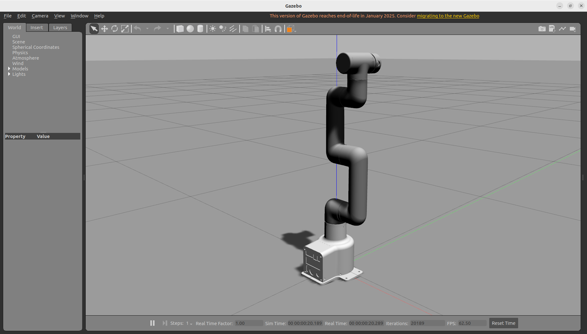
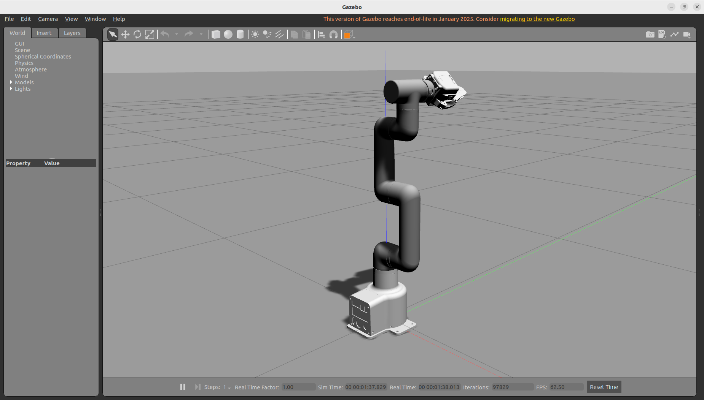
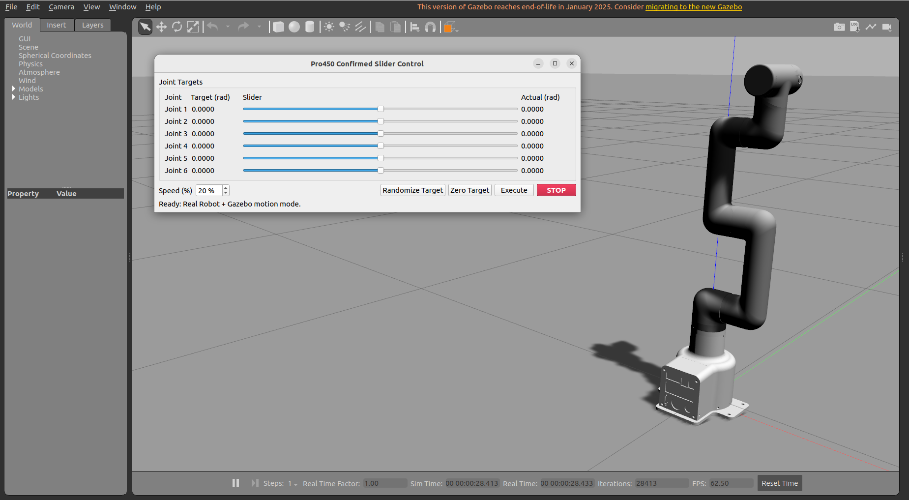
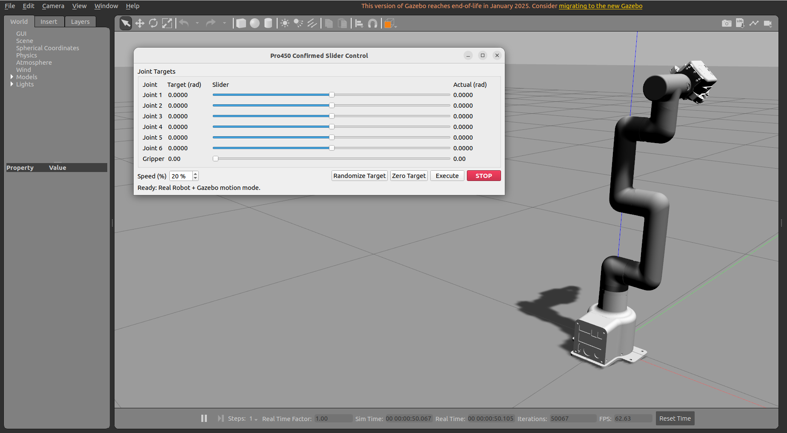
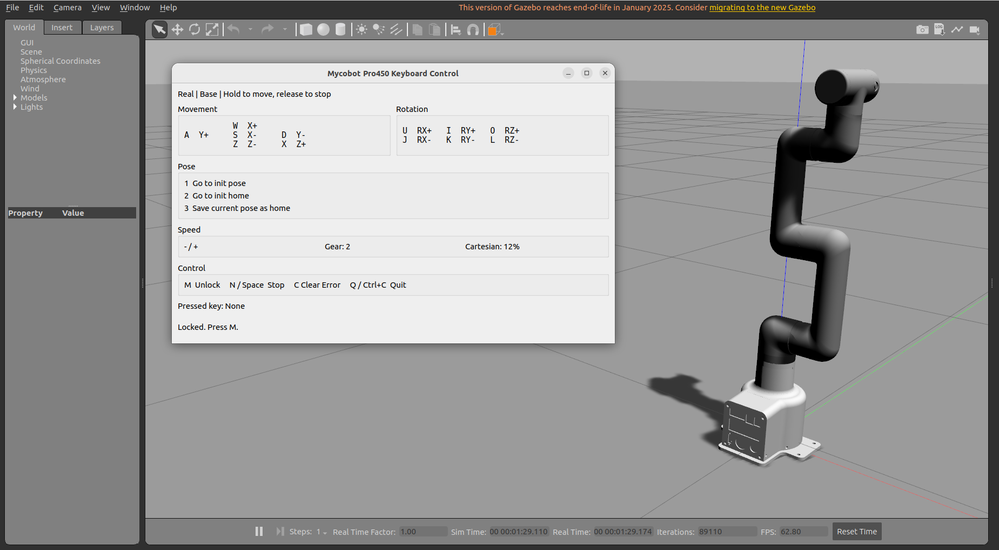
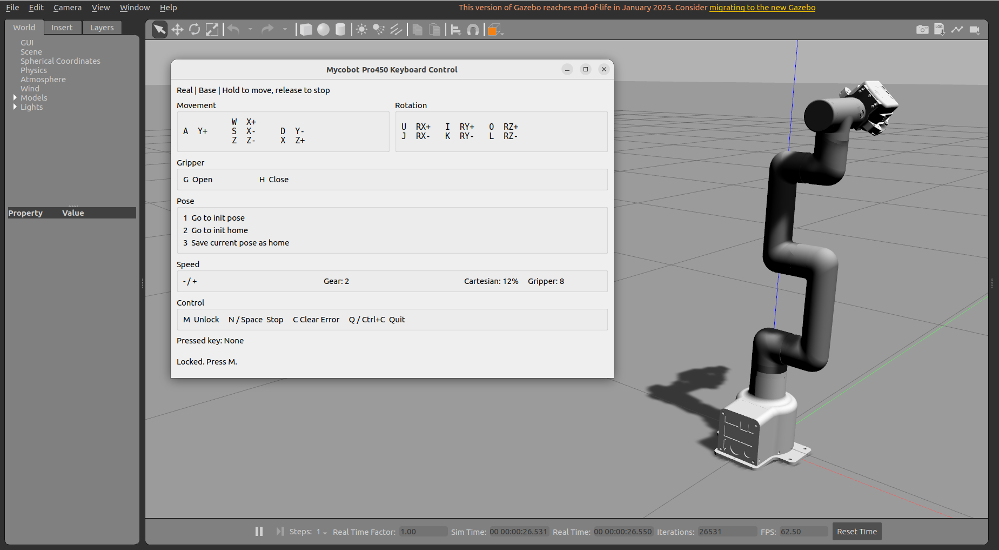
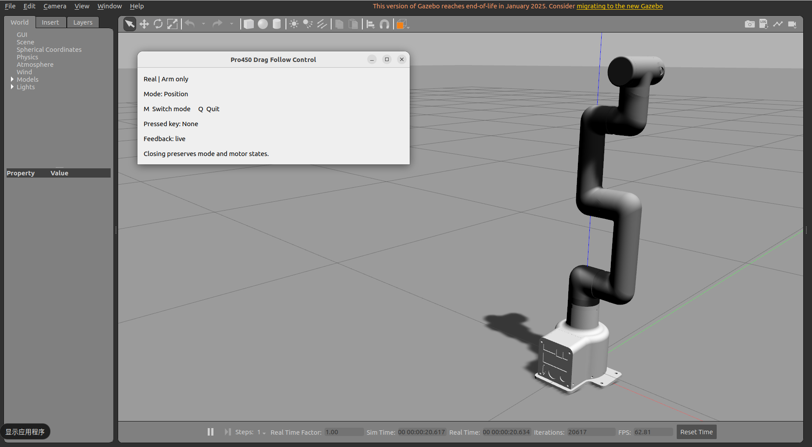
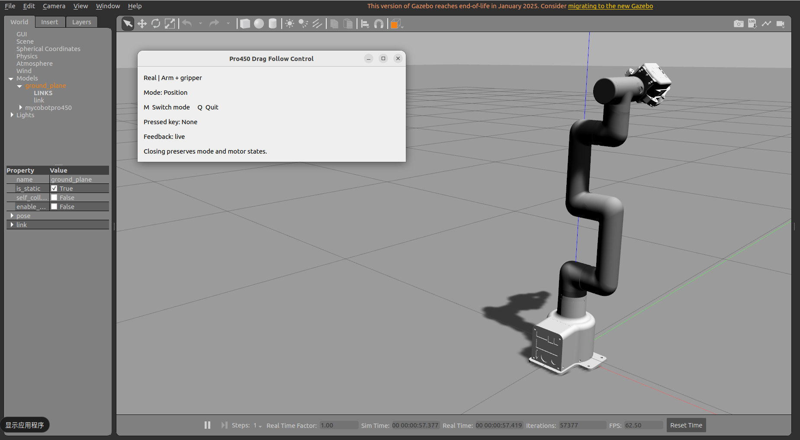
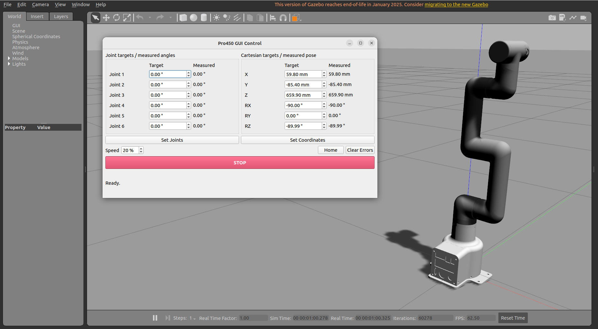
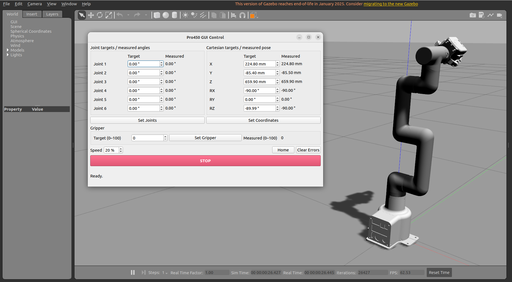

# Gazebo 仿真与控制

>> **注意：本节使用 ROS2 Humble 环境和 `mycobot_ros2` 的 `Pro450gazebo` 分支代码，使用前请安装最新的 pymycobot Python API 库。**

## 使用前准备

在使用案例功能之前，请先确认以下硬件和环境准备齐全：

- **硬件设备**  
  - MyCobot Pro 450 机械臂  
  - 网线（用于连接机械臂与电脑）  
  - 电源适配器  
  - 急停开关（确保安全操作）  
  - myGripper F100 力控夹爪（可选）  
  - **注意**：纯仿真环境不需要连接真实机械臂；真机环境需要准备上述设备。

- **软件与环境**  
  - 已安装 ROS2 Humble、Gazebo、MoveIt2 及对应依赖  
  - 已安装 `pymycobot` 库  
  - 使用真机环境时，确保 MyCobot Pro 450 已正确接通电源，并处于待机状态  
  - **注意**：Pro 450 服务端会在设备上电后自动启动，无需手动操作  
  - 使用真机环境前，需确认机械臂、末端、夹爪的固件版本为最新，并确保机械臂和夹爪通信正常。

- **网络配置**  
  - MyCobot Pro 450 默认 IP 地址：`192.168.0.232`  
  - 默认端口号：`4500`  
  - **注意**：真机环境下，PC 端需要将本机网卡 IP 设置为 **同一网段**（例如 `192.168.0.xxx`，`xxx` 为 2~254 之间的任意数，且不能与机械臂冲突）。  
  - 具体配置方式请查看 [静态IP配置](https://docs.elephantrobotics.com/docs/mycobot-pro450-cn/3-FunctionsAndApplications/5-BasicApplication/5.3-myStudioPro/5.3.1-myStudioFirstUse.html#%E9%9D%99%E6%80%81ip%E9%85%8D%E7%BD%AE) 章节内容。  
  - 示例：  
    - 机械臂 IP：`192.168.0.232`  
    - PC IP：`192.168.0.100`  
    - 子网掩码：`255.255.255.0`  
    - DNS服务器：`114.114.114.114`
  
  - **验证**：完成网络配置后，可在 PC 终端执行以下命令，若能成功返回数据包，则说明网络连接正常：
  
    ```bash
    ping 192.168.0.232
    ```

- **ROS2环境搭建**  
  - 使用案例之前，需确保已完成 [ROS2环境搭建](./6.3.1-EnvironmentSetup.md)。  
  - 本节 Gazebo 案例使用 `Pro450gazebo` 分支，请按照下面的步骤获取代码并编译。

### 有线网络通信准备

使用真机环境前，需要确认有线网关正常，才能与机械臂正常通信。使用以下命令查看有线网卡名称：

```bash
ip a
```

将下面命令中的 `<替换成你的有线网卡名称>` 替换为实际有线网卡名称，然后执行。以下沿用 README 中机械臂 IP 为 `192.168.0.230`、PC IP 为 `192.168.0.171` 的示例，使用时请对应实际设备地址。

```bash
# 确认 192.168.0.171 没有被其他电脑使用
sudo ip addr add 192.168.0.171/32 dev <替换成你的有线网卡名称>
sudo ip route replace 192.168.0.230/32 dev <替换成你的有线网卡名称> src 192.168.0.171
# 测试连接是否正常
ping -I <替换成你的有线网卡名称> 192.168.0.230
# 如果无法连接，则将 192.168.0.171 更换为其他 IP
```

### 安装依赖与获取代码

打开命令行并运行，安装 pymycobot Python API 库：

```bash
pip install pymycobot --upgrade --user
```

创建工作空间并拉取代码：

```bash
mkdir -p ~/colcon_ws/src
cd ~/colcon_ws/src
git clone --branch Pro450gazebo https://github.com/elephantrobotics/mycobot_ros2.git
```

如果已经按照前面的章节在 `~/colcon_ws/src` 中下载了 `mycobot_ros2`，则无需重复克隆。在保留已有修改的前提下，将代码切换到对应分支：

```bash
cd ~/colcon_ws/src/mycobot_ros2
git fetch origin
git switch Pro450gazebo
git pull --ff-only
```

编译并加载 ROS2 环境：

```bash
cd ~/colcon_ws
source /opt/ros/humble/setup.bash
colcon build --packages-select mycobot_description mycobotpro450_gazeboros2

# 或全量编译
# colcon build

source install/setup.bash
```

**注意：后续每次打开新的命令行，都需要先加载 ROS2 和工作空间环境，再运行对应案例的启动命令。**

```bash
source /opt/ros/humble/setup.bash
source ~/colcon_ws/install/setup.bash
```

---

## 1 启动公共环境

`mycobotpro450_gazeboros2` 软件包提供了 Gazebo 公共环境。使用滑块控制、键盘控制、拖动跟随或 GUI 控制之前，需要先启动公共环境，并保持该命令行运行。

公共环境的启动与模型显示效果如下：

<video id="gazebo-environment-video" class="video-js" controls preload="auto" width="100%"
poster="" data-setup='{"aspectRatio":"16:9"}'>

  <source src=""></video>

公共环境支持以下两种模式：

- **纯仿真环境**：设置 `environment:=simulation`，无需连接真实机械臂，Gazebo 中的机械臂默认从零位开始。
- **真机环境**：设置 `environment:=real`，连接真实机械臂。启动时会读取一次真机姿态快照，并映射到 Gazebo 环境中，之后实时跟踪真机机械臂姿态。

如果机械臂末端装有 myGripper F100 力控夹爪，或者需要在纯仿真环境中使用带夹爪的模型，则打开命令行并运行以下对应命令：

```bash
# 纯仿真环境，带夹爪
ros2 launch mycobotpro450_gazeboros2 slider.launch.py environment:=simulation with_gripper:=true

# 真机环境，带夹爪
ros2 launch mycobotpro450_gazeboros2 slider.launch.py environment:=real with_gripper:=true
```

如果机械臂末端没有 myGripper F100 力控夹爪，或者需要在纯仿真环境中使用不带夹爪的模型，则运行以下对应命令：

```bash
# 纯仿真环境，不带夹爪
ros2 launch mycobotpro450_gazeboros2 slider.launch.py environment:=simulation with_gripper:=false

# 真机环境，不带夹爪
ros2 launch mycobotpro450_gazeboros2 slider.launch.py environment:=real with_gripper:=false
```

启动成功后，会打开 Gazebo 仿真环境并显示机械臂模型。如果设置了 `with_gripper:=true`，则模型末端会带有夹爪。

不带夹爪的机械臂模型显示如下：



如果末端装有 myGripper F100 力控夹爪，则会看到以下模型：



**注意：上述命令根据实际使用环境选择一条运行即可。后续控制功能的 `environment` 参数必须与公共环境保持一致。**

### 特殊情况：机械臂本体低于水平面

如果坐标控制期间机械臂本体陷入水平面以下，可使用以下对应命令临时强制启动公共环境：

```bash
# 真机环境，带夹爪
ros2 launch mycobotpro450_gazeboros2 slider.launch.py environment:=real with_gripper:=true allow_collision:=true

# 真机环境，不带夹爪
ros2 launch mycobotpro450_gazeboros2 slider.launch.py environment:=real with_gripper:=false allow_collision:=true
```

启动后的初始阶段，角度控制会被拒绝。需通过键盘控制或 GUI 控制沿 Z 轴上移，或通过拖动跟随，使机械臂本体回到水平面以上，再使用不带 `allow_collision:=true` 的正常命令重新启动公共环境。

该模式仅临时用于坐标运动导致机械臂本体陷入水平面以下的特殊情况。脱离异常区域后，请切换回正常公共环境使用机械臂。

**注意：`allow_collision` 默认为 `false`，设置为 `true` 时仅支持真机环境，仅用于上述特殊情况的应急恢复。本工程的坐标运动保护仅限制末端，不能保证机械臂本体不与地面碰撞。末端地面保护的操作说明见本页“键盘控制”。**

## 2 滑块与随机目标

公共环境启动成功后，可以通过滑块界面设置机械臂的目标关节位置，也可以生成随机目标并执行运动。

滑块控制与随机目标的操作效果如下：

<video id="gazebo-slider-video" class="video-js" controls preload="auto" width="100%"
poster="" data-setup='{"aspectRatio":"16:9"}'>

  <source src=""></video>

保持公共环境运行，打开另一个命令行并运行：

```bash
# 纯仿真环境
ros2 launch mycobotpro450_gazeboros2 slider_control_gazebo.launch.py environment:=simulation

# 真机环境
ros2 launch mycobotpro450_gazeboros2 slider_control_gazebo.launch.py environment:=real
```

运行成功后，会打开用于滑块和随机目标操作的 Qt 界面。界面和实际功能会自动适配公共环境是否带有 myGripper F100 力控夹爪，无需再次设置 `with_gripper` 参数。

不带夹爪时，滑块控制界面及 Gazebo 运行效果如下：



如果末端装有 myGripper F100 力控夹爪，则会看到以下界面：



您可以在界面中进行以下操作：

- 拖动对应关节的滑块，或者修改目标值，设置机械臂的目标姿态。
- 通过 `Speed (%)` 调整运动速度。
- 点击 `Randomize Target`，生成六轴的随机角度；带夹爪时，也会生成夹爪随机角度。
- 点击 `Zero Target`，生成机械臂零位关节角度。
- 确认目标后，点击 `Execute`，进行检测并执行运动。
- 点击 `STOP`，请求停止运动。

**注意：修改滑块、生成随机目标或设置零位目标后，仍需点击 `Execute` 才会执行运动。**

纯仿真环境下，Gazebo 中的机械臂会向目标姿态运动。真机环境下，真实机械臂执行运动，Gazebo 中的模型跟随真机姿态。

如果检测到路径碰撞，界面会显示以下提示，并拒绝执行本次运动：

```text
Rejected: collision detected
```

此时需要调整目标姿态，再次点击 `Execute`。

## 3 键盘控制

除了滑块控制，本软件包还提供了键盘控制功能，可以通过按键控制真实机械臂的末端位置和姿态，并在 Gazebo 中显示机械臂运动效果。

键盘控制的操作效果如下：

<!-- 视频 3：键盘控制；在 source 的 src 中填写视频路径。 -->
<video id="gazebo-keyboard-video" class="video-js" controls preload="auto" width="100%"
poster="" data-setup='{"aspectRatio":"16:9"}'>

  <source src=""></video>

>> **注意：键盘控制仅支持真机环境。**

先按照“启动公共环境”中的说明，以 `environment:=real` 启动公共环境，并根据末端是否安装夹爪设置 `with_gripper` 参数。

公共环境启动成功后，打开另一个命令行并运行：

```bash
ros2 launch mycobotpro450_gazeboros2 teleop_keyboard.launch.py
```

运行成功后，会打开用于键盘控制的 Qt 界面。界面和实际功能会自动适配公共环境是否带有 myGripper F100 力控夹爪。

不带夹爪时，键盘控制界面及 Gazebo 运行效果如下：



如果末端装有 myGripper F100 力控夹爪，则会看到以下界面：



操作之前，请先点击键盘控制窗口，使窗口获得焦点。

需要先按下 `M` 解锁控制，之后再通过对应按键控制机械臂运动：

| 按键 | 功能 |
| :---: | :--- |
| `M` | 解锁控制 |
| `N` 或 `Space` | 停止并锁定 |
| `C` | 清除错误 |
| `w` / `s` | 控制位置 X |
| `a` / `d` | 控制位置 Y |
| `z` / `x` | 控制位置 Z |
| `u` / `j` | 控制姿态角 RX |
| `i` / `k` | 控制姿态角 RY |
| `o` / `l` | 控制姿态角 RZ |
| `g` / `h` | 控制夹爪开合，仅带夹爪时可用 |
| `1` | 回到机械臂零位 |
| `2` | 回到坐标控制 Home 位 |
| `3` | 将当前位置设置为坐标控制 Home 位，下次启动时需重新设置 |
| `-` / `+` | 切换速度档位 |
| `Q` | 关闭窗口退出 |

按住对应按键，机械臂会持续运动；松开按键后停止。窗口失去焦点时，也会停止运动。

**注意：按键控制运动期间，请等待当前运动结束后再开始下一次运动；否则会触发软锁，需再次按 `M` 解锁后方可继续控制。**

按键控制不区分大小写。108 键布局下，主键盘区的 `-`（`_`）、`+`（`=`），以及小键盘区的 `-` / `+`，均可切换速度档位。

界面会持续显示可操作按键、当前设定速度、速度档位、当前有效按键和提示信息。您可以先选择较低的速度档位，再进行坐标控制。

装有 myGripper F100 力控夹爪时，坐标控制的末端会自动延伸至夹爪末端。

**注意：使用夹爪控制按键前，请确认公共环境以 `with_gripper:=true` 启动。真机环境下还需确保 myGripper F100 力控夹爪已连接至机械臂末端。**

### 奇异位姿恢复

坐标控制进入奇异位姿时，机械臂 link5 的 LED 光圈变为蓝色，界面底部显示：

```text
Motion rejected: singular position
```

此时先按 `C` 清除错误，再按 `M` 解锁，即可恢复键盘控制。建议随后按 `2` 回到坐标控制 Home 位，避免在当前位姿继续运动时再次进入奇异位姿。

执行零位运动后也会进入奇异位姿，需要依次按 `C` 清错、`M` 解锁，再按 `2` 回到坐标控制 Home 位。

### 末端地面保护

控制期间不允许运动到水平面以下。末端距地面 20 mm 时会触发保护机制，需先长按 `X` 向上运动，脱离触发区域后才能继续使用其他运动按键；此时仍可调整速度档位。

**注意：该保护机制仅限制末端，不能保证机械臂本体不与地面碰撞，操作时需谨慎。**

### 错误码 33 的处理

错误码 33 表示无法求得连续的直线运动解。出现该错误时，LED 光圈可能先变为蓝色，再闪一下红色，随后恢复绿色，界面底部显示：

```text
Controller error 33
```

此时先按 `C` 清除错误，再按 `M` 解锁，随后可恢复键盘控制。建议按 `2` 回到坐标控制 Home 位，避免在当前位姿继续运动时再次触发错误，甚至导致机械臂重启。

## 4 拖动跟随

除了通过界面控制机械臂，还可以手动拖动真实机械臂，让 Gazebo 中的模型跟随真机运动。

真机拖动与 Gazebo 模型跟随效果如下：

<video id="gazebo-drag-follow-video" class="video-js" controls preload="auto" width="100%"
poster="" data-setup='{"aspectRatio":"16:9"}'>

  <source src=""></video>

>> **注意：拖动跟随仅支持真机环境。**

先按照“启动公共环境”中的说明，以 `environment:=real` 启动公共环境，并根据末端是否安装夹爪设置 `with_gripper` 参数。

公共环境启动成功后，打开另一个命令行并运行：

```bash
ros2 launch mycobotpro450_gazeboros2 drag_follow_gazebo.launch.py
```

运行成功后，会打开用于拖动跟随的 Qt 界面。界面和实际功能会自动适配公共环境是否带有 myGripper F100 力控夹爪。

不带夹爪时，拖动跟随界面及 Gazebo 模型跟随效果如下：



如果末端装有 myGripper F100 力控夹爪，则会看到以下界面：



点击拖动跟随窗口，使窗口获得焦点，然后按以下步骤操作：

1. 按下 `M`，控制六轴进入零力拖动模式，并使夹爪失能。
2. 听到机械臂发出两声咔咔声后，托住机械臂手动拖动，Gazebo 公共环境中的机械臂模型会跟随真机运动。
3. 如果安装了 myGripper F100 力控夹爪，夹爪失能后可手动掰动，观察模型中的夹爪跟随效果。
4. 拖动结束前，将机械臂移动到零位附近，并确认关节未超限。
5. 再次按下 `M`，锁紧六轴和夹爪。
6. 按下 `Q`，关闭窗口退出。

拖动跟随期间，如果关节超限，LED 光圈会变为蓝色，此时仍可正常进行拖动操作。程序退出时会自动清错。

**注意：拖动结束后再次按下 `M`，确认六轴和夹爪已锁紧。**

## 5 GUI 控制

本软件包还提供了 GUI 控制界面，可以输入目标关节角度或末端坐标控制真实机械臂，并在 Gazebo 中显示机械臂运动效果。

GUI 控制的操作效果如下：

<video id="gazebo-gui-video" class="video-js" controls preload="auto" width="100%"
poster="" data-setup='{"aspectRatio":"16:9"}'>

  <source src=""></video>

>> **注意：GUI 控制仅支持真机环境。**

先按照“启动公共环境”中的说明，以 `environment:=real` 启动公共环境，并根据末端是否安装夹爪设置 `with_gripper` 参数。

公共环境启动成功后，打开另一个命令行并运行：

```bash
ros2 launch mycobotpro450_gazeboros2 gui_control_gazebo.launch.py
```

运行成功后，会打开用于 GUI 控制的 Qt 界面。界面和实际功能会自动适配公共环境是否带有 myGripper F100 力控夹爪。

不带夹爪时，GUI 控制界面及 Gazebo 运行效果如下：



如果末端装有 myGripper F100 力控夹爪，则会看到以下界面：



您可以在界面中进行以下操作：

- 设置运动速度，输入六个关节的目标角度，点击 `Set Joints`，执行角度运动。
- 坐标控制前，先点击 `Home`，进入坐标控制 Home 位。
- 输入目标末端坐标和姿态，点击 `Set Coordinates`，执行坐标运动。`Home` 按钮也可用于脱离奇异位姿。
- 如果安装了 myGripper F100 力控夹爪，输入夹爪目标值后，点击 `Set Gripper`，执行夹爪运动。
- 点击 `STOP`，请求停止运动。
- 点击 `Clear Errors`，清除机械臂错误。

执行运动时，可以观察界面中的实际角度和末端位姿，以及 Gazebo 中机械臂模型的跟随效果。

装有 myGripper F100 力控夹爪时，坐标控制的末端会自动延伸至夹爪末端。

当输入坐标为奇异位置时，机械臂可能在运动过程中停止，界面显示以下提示，link5 的 LED 光圈变成蓝色：

```text
Motion rejected: singular position
```

此时可通过 `Set Joints` 进行角度控制，脱离奇异位姿后再继续坐标运动；也可直接点击 `Home`，回到坐标控制 Home 位。随后点击 `Clear Errors` 清错，使 LED 光圈恢复绿色。

如果进入奇异位姿后 LED 光圈已自动恢复绿色，则无需点击 `Clear Errors`，即可继续运动。坐标运动特殊情况的详细说明见本页“键盘控制”。

如果角度运动的路径检测到碰撞，界面会显示以下提示，并拒绝执行：

```text
Rejected: collision detected
```

---

[← 上一页](./6.3.4-RViz2_MoveIt2_Control.md) | [下一页 →](./6.3.6-Troubleshooting.md)
