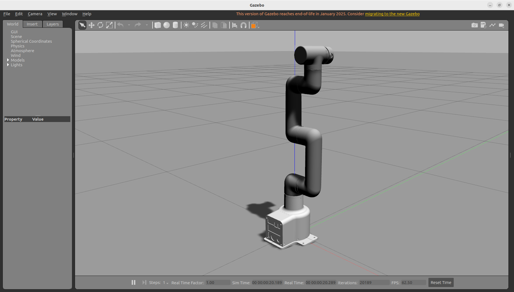
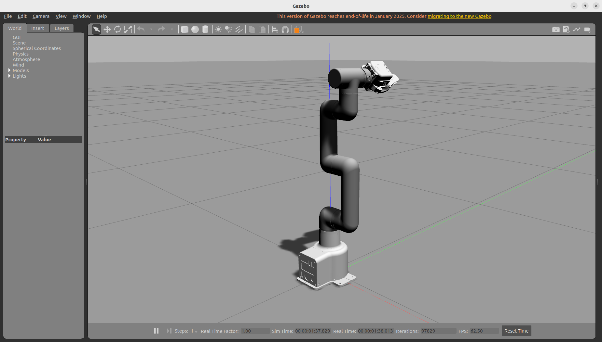
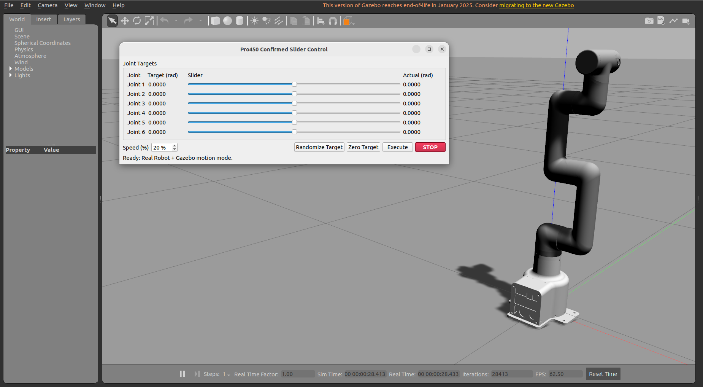
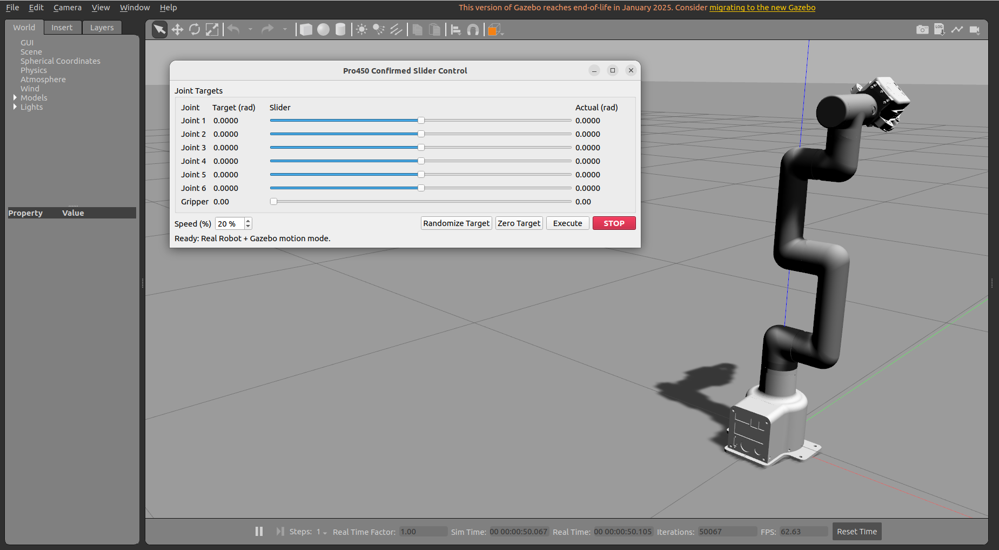
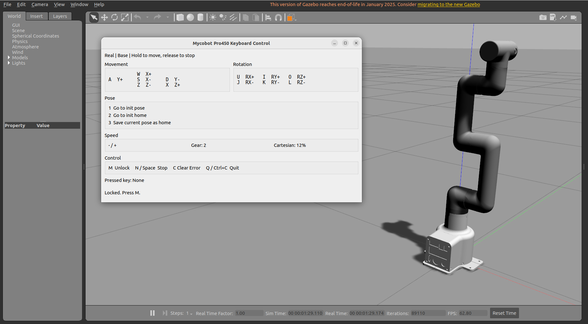
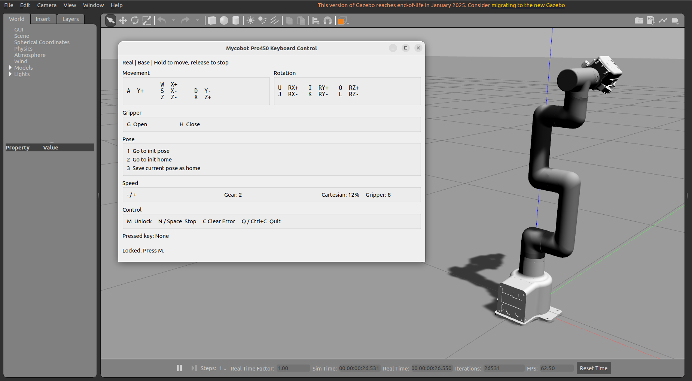
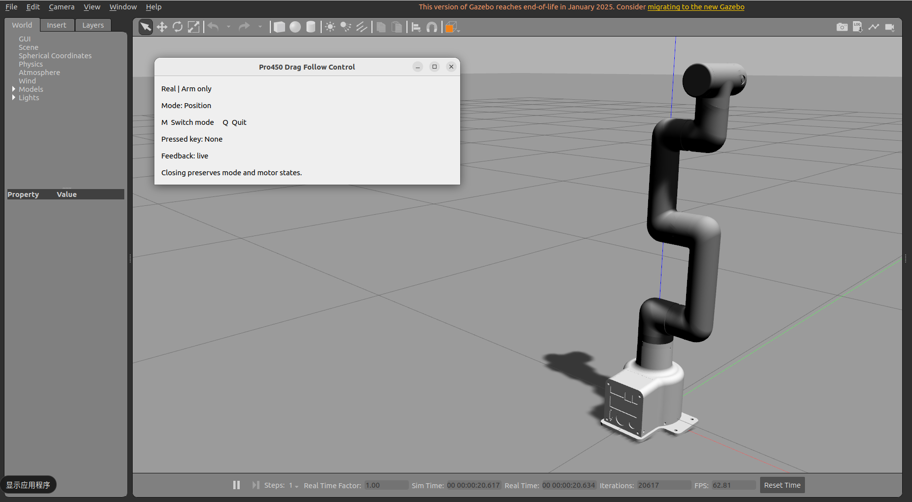
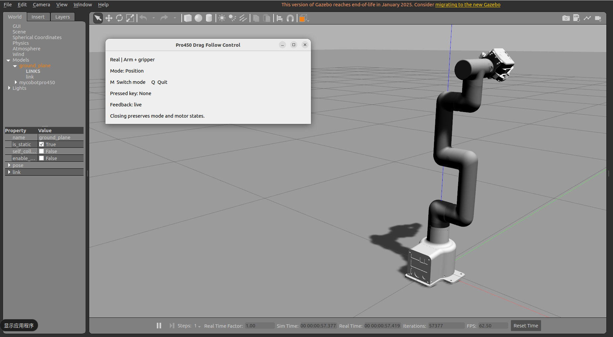
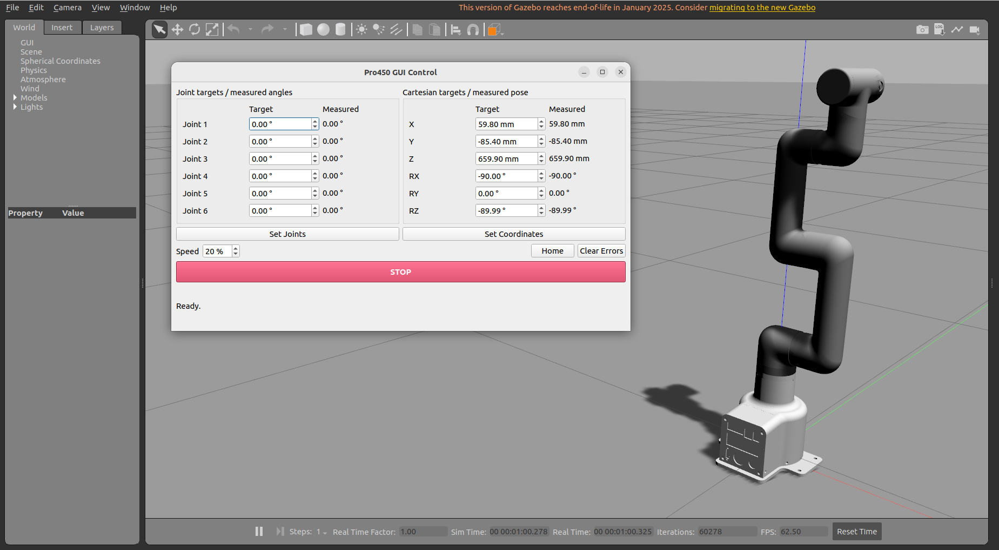
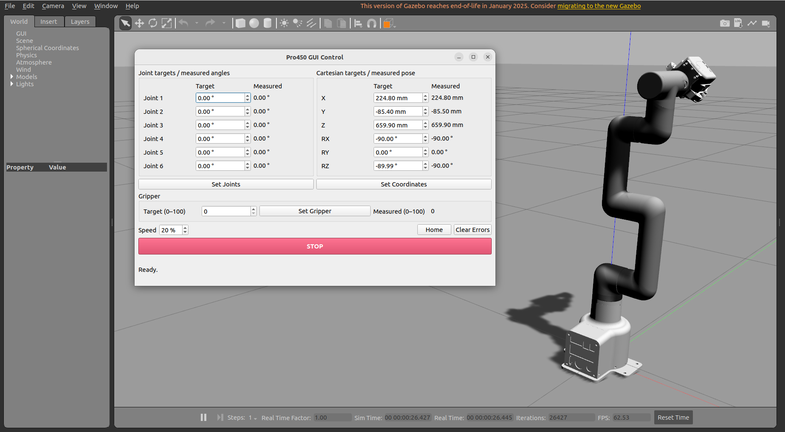

# Gazebo Simulation and Control

>> **Note: This section uses ROS2 Humble and the `Pro450gazebo` branch of `mycobot_ros2`. Install the latest pymycobot Python API library before use.**

## Preparation Before Use

Before using the example functions, make sure the following hardware and environment are ready:

- **Hardware**  
  - MyCobot Pro 450 robotic arm  
  - Ethernet cable (to connect the robotic arm to the computer)  
  - Power adapter  
  - Emergency stop switch (for safe operation)  
  - myGripper F100 force-controlled gripper (optional)  
  - **Note**: The simulation-only environment does not require a physical robotic arm. The real-robot environment requires the equipment listed above.

- **Software and Environment**  
  - ROS2 Humble, Gazebo, MoveIt2, and the corresponding dependencies installed  
  - The `pymycobot` library installed  
  - When using the real-robot environment, make sure MyCobot Pro 450 is properly powered on and in standby mode  
  - **Note**: The Pro 450 server starts automatically when the device is powered on. No manual operation is required  
  - Before using the real-robot environment, confirm that the robotic arm, end effector, and gripper have the latest firmware, and that communication with the robotic arm and gripper is normal.

- **Network Configuration**  
  - Default MyCobot Pro 450 IP address: `192.168.0.232`  
  - Default port: `4500`  
  - **Note**: In the real-robot environment, set the PC network adapter IP address to **the same subnet** (for example, `192.168.0.xxx`, where `xxx` is any number from 2 to 254 that does not conflict with the robotic arm).  
  - For configuration details, see [Static IP Configuration](https://docs.elephantrobotics.com/docs/mycobot-pro450-cn/3-FunctionsAndApplications/5-BasicApplication/5.3-myStudioPro/5.3.1-myStudioFirstUse.html#%E9%9D%99%E6%80%81ip%E9%85%8D%E7%BD%AE).  
  - Example:  
    - Robotic arm IP: `192.168.0.232`  
    - PC IP: `192.168.0.100`  
    - Subnet mask: `255.255.255.0`  
    - DNS server: `114.114.114.114`
  
  - **Verification**: After configuring the network, run the following command in a PC terminal. A successful response indicates that the network connection is working:
  
    ```bash
    ping 192.168.0.232
    ```

- **ROS2 Environment Setup**  
  - Before using the examples, make sure you have completed [ROS2 Environment Setup](./6.3.1-Environment_Setup.md).  
  - The Gazebo examples in this section use the `Pro450gazebo` branch. Follow the steps below to obtain and build the code.

### Wired Network Communication Preparation

Before using the real-robot environment, confirm that the wired gateway is working so that communication with the robotic arm is normal. Use the following command to check the wired network interface name:

```bash
ip a
```

Replace `<your_wired_interface_name>` in the commands below with the actual wired network interface name, then run the commands. The following uses the README example with robotic arm IP `192.168.0.230` and PC IP `192.168.0.171`. Use the actual device addresses when operating.

```bash
# Confirm that 192.168.0.171 is not being used by another computer
sudo ip addr add 192.168.0.171/32 dev <your_wired_interface_name>
sudo ip route replace 192.168.0.230/32 dev <your_wired_interface_name> src 192.168.0.171
# Test the connection
ping -I <your_wired_interface_name> 192.168.0.230
# If the connection fails, replace 192.168.0.171 with another IP address
```

### Installing Dependencies and Obtaining the Code

Open a terminal and run the following command to install the pymycobot Python API library:

```bash
pip install pymycobot --upgrade --user
```

Create a workspace and clone the code:

```bash
mkdir -p ~/colcon_ws/src
cd ~/colcon_ws/src
git clone --branch Pro450gazebo https://github.com/elephantrobotics/mycobot_ros2.git
```

If you have already downloaded `mycobot_ros2` into `~/colcon_ws/src` by following the previous sections, you do not need to clone it again. Preserve your existing changes before switching the code to the corresponding branch:

```bash
cd ~/colcon_ws/src/mycobot_ros2
git fetch origin
git switch Pro450gazebo
git pull --ff-only
```

Build and load the ROS2 environment:

```bash
cd ~/colcon_ws
source /opt/ros/humble/setup.bash
colcon build --packages-select mycobot_description mycobotpro450_gazeboros2

# Or build the entire workspace
# colcon build

source install/setup.bash
```

**Note: Each time you open a new terminal for the following steps, load the ROS2 and workspace environments before running the launch command for the corresponding example.**

```bash
source /opt/ros/humble/setup.bash
source ~/colcon_ws/install/setup.bash
```

---

## 1 Starting the Shared Environment

The `mycobotpro450_gazeboros2` package provides a shared Gazebo environment. Before using slider control, keyboard control, drag following, or GUI control, start the shared environment and keep its terminal running.

The shared environment startup and model display are shown below:

<video id="gazebo-environment-video" class="video-js" controls preload="auto" width="100%"
poster="" data-setup='{"aspectRatio":"16:9"}'>

  <source src=""></video>

The shared environment supports the following two modes:

- **Simulation-only environment**: Set `environment:=simulation`. No physical robotic arm is required, and the robotic arm in Gazebo starts at the zero position by default.
- **Real-robot environment**: Set `environment:=real` to connect to a physical robotic arm. At startup, a snapshot of the real robot's pose is read and mapped into the Gazebo environment. The real robot's pose is then tracked in real time.

If the robotic arm has a myGripper F100 force-controlled gripper, or you want to use a model with a gripper in the simulation-only environment, open a terminal and run the appropriate command below:

```bash
# Simulation-only environment, with gripper
ros2 launch mycobotpro450_gazeboros2 slider.launch.py environment:=simulation with_gripper:=true

# Real-robot environment, with gripper
ros2 launch mycobotpro450_gazeboros2 slider.launch.py environment:=real with_gripper:=true
```

If the robotic arm does not have a myGripper F100 force-controlled gripper, or you want to use a model without a gripper in the simulation-only environment, run the appropriate command below:

```bash
# Simulation-only environment, without gripper
ros2 launch mycobotpro450_gazeboros2 slider.launch.py environment:=simulation with_gripper:=false

# Real-robot environment, without gripper
ros2 launch mycobotpro450_gazeboros2 slider.launch.py environment:=real with_gripper:=false
```

After a successful startup, the Gazebo simulation environment opens and displays the robotic arm model. If `with_gripper:=true` is set, the model has a gripper at its end.

The robotic arm model without a gripper is shown below:



If a myGripper F100 force-controlled gripper is installed at the end, you will see the following model:



**Note: Run only one of the commands above, according to the environment you are using. The `environment` parameter of subsequent control functions must match the shared environment.**

### Special Case: The Robotic Arm Body Is Below the Horizontal Plane

If the robotic arm body moves below the horizontal plane during Cartesian control, use the appropriate command below to temporarily force the shared environment to start:

```bash
# Real-robot environment, with gripper
ros2 launch mycobotpro450_gazeboros2 slider.launch.py environment:=real with_gripper:=true allow_collision:=true

# Real-robot environment, without gripper
ros2 launch mycobotpro450_gazeboros2 slider.launch.py environment:=real with_gripper:=false allow_collision:=true
```

During the initial stage after startup, joint-angle control is rejected. Use keyboard control or GUI control to move upward along the Z axis, or use drag following, to bring the robotic arm body back above the horizontal plane. Then restart the shared environment using a normal command without `allow_collision:=true`.

This mode is only for temporary use when Cartesian motion has caused the robotic arm body to move below the horizontal plane. After leaving the abnormal area, switch back to the normal shared environment to use the robotic arm.

**Note: `allow_collision` defaults to `false`. Setting it to `true` is supported only in the real-robot environment and is intended only for emergency recovery in the special case above. The Cartesian motion protection in this project only restricts the end effector and cannot guarantee that the robotic arm body will not collide with the ground. See "Keyboard Control" on this page for instructions on end-effector ground protection.**

## 2 Sliders and Random Targets

After the shared environment starts successfully, you can use the slider interface to set target joint positions, or generate a random target and execute the motion.

Slider control and random target operation are shown below:

<video id="gazebo-slider-video" class="video-js" controls preload="auto" width="100%"
poster="" data-setup='{"aspectRatio":"16:9"}'>

  <source src=""></video>

Keep the shared environment running, open another terminal, and run:

```bash
# Simulation-only environment
ros2 launch mycobotpro450_gazeboros2 slider_control_gazebo.launch.py environment:=simulation

# Real-robot environment
ros2 launch mycobotpro450_gazeboros2 slider_control_gazebo.launch.py environment:=real
```

After a successful startup, a Qt interface for sliders and random targets opens. The interface and functions automatically adapt to whether the shared environment includes a myGripper F100 force-controlled gripper. You do not need to set the `with_gripper` parameter again.

Without a gripper, the slider control interface and Gazebo operation are shown below:



If a myGripper F100 force-controlled gripper is installed at the end, you will see the following interface:



You can perform the following operations in the interface:

- Drag the slider for a joint, or change its target value, to set the target pose of the robotic arm.
- Adjust the motion speed using `Speed (%)`.
- Click `Randomize Target` to generate random angles for the six axes. If a gripper is present, a random gripper angle is also generated.
- Click `Zero Target` to generate the robotic arm's zero-position joint angles.
- After confirming the target, click `Execute` to check and execute the motion.
- Click `STOP` to request a stop.

**Note: After changing a slider, generating a random target, or setting a zero-position target, you must still click `Execute` to execute the motion.**

In the simulation-only environment, the robotic arm in Gazebo moves toward the target pose. In the real-robot environment, the physical robotic arm executes the motion, and the Gazebo model follows the real robot's pose.

If a path collision is detected, the interface displays the following message and rejects the motion:

```text
Rejected: collision detected
```

Adjust the target pose, then click `Execute` again.

## 3 Keyboard Control

In addition to slider control, this package provides keyboard control. You can use keys to control the physical robotic arm's end-effector position and orientation, and view its motion in Gazebo.

Keyboard control operation is shown below:

<!-- Video 3: Keyboard control. Enter the video path in the source src attribute. -->
<video id="gazebo-keyboard-video" class="video-js" controls preload="auto" width="100%"
poster="" data-setup='{"aspectRatio":"16:9"}'>

  <source src=""></video>

>> **Note: Keyboard control supports only the real-robot environment.**

First follow "Starting the Shared Environment" to start the shared environment with `environment:=real`, and set `with_gripper` according to whether a gripper is installed at the end.

After the shared environment starts successfully, open another terminal and run:

```bash
ros2 launch mycobotpro450_gazeboros2 teleop_keyboard.launch.py
```

After a successful startup, a Qt interface for keyboard control opens. The interface and functions automatically adapt to whether the shared environment includes a myGripper F100 force-controlled gripper.

Without a gripper, the keyboard control interface and Gazebo operation are shown below:



If a myGripper F100 force-controlled gripper is installed at the end, you will see the following interface:



Before operating, click the keyboard control window to give it focus.

First press `M` to unlock control, then use the corresponding keys to control the robotic arm:

| Key | Function |
| :---: | :--- |
| `M` | Unlock control |
| `N` or `Space` | Stop and lock |
| `C` | Clear errors |
| `w` / `s` | Control position X |
| `a` / `d` | Control position Y |
| `z` / `x` | Control position Z |
| `u` / `j` | Control orientation angle RX |
| `i` / `k` | Control orientation angle RY |
| `o` / `l` | Control orientation angle RZ |
| `g` / `h` | Open or close the gripper; available only with a gripper |
| `1` | Return to the robotic arm's zero position |
| `2` | Return to the Cartesian control Home pose |
| `3` | Set the current position as the Cartesian control Home pose; this must be set again on the next startup |
| `-` / `+` | Switch speed levels |
| `Q` | Close the window and exit |

Hold the corresponding key to keep the robotic arm moving. Release the key to stop. Motion also stops when the window loses focus.

**Note: During keyboard-controlled motion, wait for the current motion to finish before starting the next motion. Otherwise, a soft lock is triggered, and you must press `M` again to unlock control before continuing.**

Key control is case-insensitive. On a 108-key layout, both `-` (`_`) and `+` (`=`) in the main keyboard area and `-` / `+` on the numeric keypad can switch speed levels.

The interface continuously displays available keys, the current speed setting, the speed level, the currently active key, and messages. You can select a lower speed level before using Cartesian control.

When a myGripper F100 force-controlled gripper is installed, the end point for Cartesian control is automatically extended to the gripper tip.

**Note: Before using the gripper control keys, confirm that the shared environment was started with `with_gripper:=true`. In the real-robot environment, also make sure the myGripper F100 force-controlled gripper is connected to the end of the robotic arm.**

### Recovering from a Singular Pose

When Cartesian control enters a singular pose, the LED ring on link5 of the robotic arm turns blue, and the bottom of the interface displays:

```text
Motion rejected: singular position
```

First press `C` to clear the error, then press `M` to unlock and restore keyboard control. It is recommended to then press `2` to return to the Cartesian control Home pose, to avoid entering a singular pose again when continuing to move from the current pose.

Executing a zero-position motion also enters a singular pose. Press `C` to clear the error, press `M` to unlock, then press `2` to return to the Cartesian control Home pose.

### End-Effector Ground Protection

Motion below the horizontal plane is not allowed during control. Protection is triggered when the end effector is 20 mm from the ground. First hold `X` to move upward and leave the trigger area before using other motion keys. Speed levels can still be adjusted during this time.

**Note: This protection only restricts the end effector and cannot guarantee that the robotic arm body will not collide with the ground. Operate with care.**

### Handling Error Code 33

Error code 33 means that a continuous linear motion solution cannot be found. When this error occurs, the LED ring may turn blue, flash red once, and then return to green. The bottom of the interface displays:

```text
Controller error 33
```

First press `C` to clear the error, then press `M` to unlock and restore keyboard control. It is recommended to press `2` to return to the Cartesian control Home pose, to avoid triggering the error again or even causing the robotic arm to restart when continuing to move from the current pose.

## 4 Drag Following

In addition to controlling the robotic arm through the interface, you can manually drag the physical robotic arm and have the Gazebo model follow its motion.

Real-robot dragging and Gazebo model following are shown below:

<video id="gazebo-drag-follow-video" class="video-js" controls preload="auto" width="100%"
poster="" data-setup='{"aspectRatio":"16:9"}'>

  <source src=""></video>

>> **Note: Drag following supports only the real-robot environment.**

First follow "Starting the Shared Environment" to start the shared environment with `environment:=real`, and set `with_gripper` according to whether a gripper is installed at the end.

After the shared environment starts successfully, open another terminal and run:

```bash
ros2 launch mycobotpro450_gazeboros2 drag_follow_gazebo.launch.py
```

After a successful startup, a Qt interface for drag following opens. The interface and functions automatically adapt to whether the shared environment includes a myGripper F100 force-controlled gripper.

Without a gripper, the drag-following interface and Gazebo model following are shown below:



If a myGripper F100 force-controlled gripper is installed at the end, you will see the following interface:



Click the drag-following window to give it focus, then follow these steps:

1. Press `M` to put the six axes into zero-force dragging mode and disable the gripper.
2. After hearing two clicks from the robotic arm, support it and drag it manually. The robotic arm model in the shared Gazebo environment follows the real robot's motion.
3. If a myGripper F100 force-controlled gripper is installed, you can manually move the gripper after it is disabled and observe the model gripper following it.
4. Before finishing dragging, move the robotic arm near the zero position and confirm that no joint is beyond its limits.
5. Press `M` again to lock the six axes and gripper.
6. Press `Q` to close the window and exit.

If a joint exceeds its limits during drag following, the LED ring turns blue, and dragging can still be performed normally. The program automatically clears errors on exit.

**Note: After dragging, press `M` again and confirm that the six axes and gripper are locked.**

## 5 GUI Control

This package also provides a GUI control interface. You can enter target joint angles or end-effector coordinates to control the physical robotic arm, and view its motion in Gazebo.

GUI control operation is shown below:

<video id="gazebo-gui-video" class="video-js" controls preload="auto" width="100%"
poster="" data-setup='{"aspectRatio":"16:9"}'>

  <source src=""></video>

>> **Note: GUI control supports only the real-robot environment.**

First follow "Starting the Shared Environment" to start the shared environment with `environment:=real`, and set `with_gripper` according to whether a gripper is installed at the end.

After the shared environment starts successfully, open another terminal and run:

```bash
ros2 launch mycobotpro450_gazeboros2 gui_control_gazebo.launch.py
```

After a successful startup, a Qt interface for GUI control opens. The interface and functions automatically adapt to whether the shared environment includes a myGripper F100 force-controlled gripper.

Without a gripper, the GUI control interface and Gazebo operation are shown below:



If a myGripper F100 force-controlled gripper is installed at the end, you will see the following interface:



You can perform the following operations in the interface:

- Set the motion speed, enter target angles for the six joints, and click `Set Joints` to execute joint-angle motion.
- Before using Cartesian control, click `Home` to enter the Cartesian control Home pose.
- Enter the target end-effector coordinates and orientation, then click `Set Coordinates` to execute Cartesian motion. The `Home` button can also be used to leave a singular pose.
- If a myGripper F100 force-controlled gripper is installed, enter the gripper target value and click `Set Gripper` to execute gripper motion.
- Click `STOP` to request a stop.
- Click `Clear Errors` to clear robotic arm errors.

During motion, you can observe the actual angles and end-effector pose in the interface, and the robotic arm model following in Gazebo.

When a myGripper F100 force-controlled gripper is installed, the end point for Cartesian control is automatically extended to the gripper tip.

If the entered coordinates are at a singular position, the robotic arm may stop during motion. The interface displays the following message, and the LED ring on link5 turns blue:

```text
Motion rejected: singular position
```

Use `Set Joints` for joint-angle control to leave the singular pose before continuing Cartesian motion. Alternatively, click `Home` to return to the Cartesian control Home pose. Then click `Clear Errors` to clear the error and restore the LED ring to green.

If the LED ring has already returned to green automatically after entering a singular pose, you can continue moving without clicking `Clear Errors`. See "Keyboard Control" on this page for details on special cases in Cartesian motion.

If a collision is detected along the joint-angle motion path, the interface displays the following message and rejects execution:

```text
Rejected: collision detected
```

---

[← Previous Page](./6.3.4-RViz2_MoveIt2_Control.md) | [Next Page →](./6.3.6-Troubleshooting.md)
